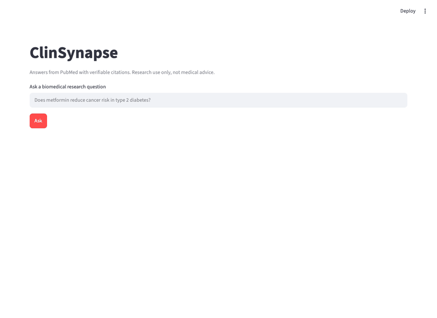
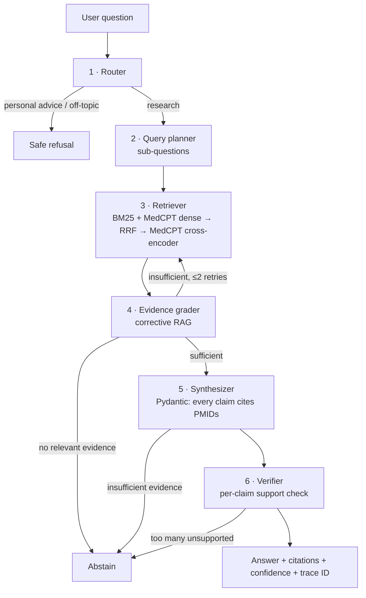

# ClinSynapse

**An agentic biomedical question-answering system that answers from PubMed with verifiable citations, abstains when the evidence is weak, and is continuously evaluated in CI so quality can't silently regress.**

> Research use only. Not medical advice.



<sub>Live run (sped up): node-by-node progress, a yes/no verdict, every claim linked to its PubMed article, and the supporting sentence highlighted in the cited abstract.</sub>

## Highlights

| | |
|---|---|
| 🔎 **Retrieval** | **97.2% Recall@8** over **273,518 PubMed abstracts** (hybrid BM25 + MedCPT, cross-encoder reranking; 1,000 questions) |
| 📎 **Verifiable citations** | **100% citation validity**: every cited PMID was actually retrieved; **93%** of gold abstracts cited |
| ✅ **Faithfulness** | The agent's verify-and-retry loop raises claim faithfulness by **+6.9 pts (p = 0.003)** over single-shot RAG |
| 🛑 **Knows when not to answer** | **95%** correct abstention on unanswerable questions; **30 / 30** unsafe medical-advice and off-topic prompts refused |
| 🛡️ **Robust** | **0 / 300** indirect prompt-injection attacks succeeded |
| 🧪 **Evals that catch breakage** | Fault injection caught **4 / 4** planted faults (corrupted numbers, swapped citations, missing evidence, injected instructions) |
| 📊 **Statistical rigor** | Bootstrap 95% CIs on every metric and paired permutation tests for every A/B comparison |
| 🚦 **CI quality gate** | Every PR replays a cached smoke eval and fails on a statistically significant drop in faithfulness, citation validity, accuracy or refusal accuracy |
| 🎯 **Curated golden set** | **94.8%** accuracy on 109 two-model-verified questions |

## Architecture



| Component | Choice |
|---|---|
| Orchestration | LangGraph, with per-query budgets on steps, tokens and wall-clock time and graceful degradation |
| Corpus | 273,518 real PubMed abstracts (PubMedQA labeled + unlabeled + artificial); titles and conclusions excluded so gold answers can't leak |
| Sparse | `bm25s` in-process |
| Dense | MedCPT article/query encoders → Qdrant (embedded, or server via `CS_QDRANT_URL`) |
| Fusion and rerank | Reciprocal rank fusion → MedCPT cross-encoder |
| LLMs | `gpt-oss-120b` (main) and `DeepSeek-V4.1-Flash` (comparison) via [Virginia Tech ARC's LLM API](https://docs.arc.vt.edu/ai/011_llm_api_arc_vt_edu.html); any OpenAI-compatible endpoint works via `CS_LLM_BASE_URL` |
| Determinism | Temperature 0, pinned models, SQLite cache keyed by prompt hash for LLM calls, retrieval and judge verdicts |
| Safety | Router refusals, retrieved abstracts wrapped as untrusted data, indirect prompt-injection tests |
| Serving | FastAPI with streaming (SSE), Streamlit UI, Docker Compose, optional Langfuse tracing |

## Results

All agent results use 300 held-out PubMedQA questions with open retrieval: the system must find the gold abstract among 273,518, not be handed it. Values are means with bootstrap 95% CIs; Δ values are paired permutation tests on the same questions.

### Retrieval (all 1,000 PubMedQA questions)

| Retriever | Recall@1 | Recall@8 | MRR | nDCG@10 | ms/query |
|---|---|---|---|---|---|
| BM25 | 0.712 [0.68, 0.74] | 0.884 | 0.778 | 0.805 | 3 |
| Dense (MedCPT) | 0.670 [0.64, 0.70] | 0.908 | 0.760 | 0.798 | 66 |
| Hybrid (RRF) | 0.756 [0.73, 0.78] | 0.938 | 0.828 | 0.856 | 52 |
| BM25 + rerank | 0.831 [0.81, 0.85] | 0.951 | 0.879 | 0.897 | 373 |
| Dense + rerank | 0.846 [0.82, 0.87] | 0.966 | 0.894 | 0.913 | 434 |
| **Hybrid + rerank** | 0.844 [0.82, 0.87] | **0.972** | **0.895** | **0.915** | 712 |

The cross-encoder reranker is the largest single gain (+9 to +18 pts Recall@1), and hybrid fusion beats either retriever alone.

### Grounded answers: agent vs single-shot RAG

| Config | Faithfulness | Citation validity | Citation recall | Macro-F1 | Tokens/query |
|---|---|---|---|---|---|
| **Full agent** (gpt-oss-120b) | **0.742** [0.70, 0.78] | **1.000** | 0.930 [0.90, 0.96] | 0.561 [0.50, 0.61] | 8.8k |
| Single-shot RAG | 0.668 [0.62, 0.72] | 1.000 | 0.950 [0.93, 0.98] | 0.584 [0.52, 0.64] | 3.6k |
| Always answer "yes" | – | – | – | 0.231 | 0 |

- The agent raises faithfulness by **+6.9 pts (p = 0.003)**: its claims are more often fully supported by the abstracts they cite.
- PubMedQA yes/no accuracy is 0.603 [0.55, 0.66] for the agent and 0.633 for single-shot (no significant difference), on the open-retrieval setting with abstract conclusions removed.
- Full pipeline latency: p50 13.5 s, p95 39.4 s. Reference cost ≈ $2.07 per 1,000 queries at public gpt-oss-120b list prices.

### What each component contributes

| Component | Measured gain (paired Δ) | Cost |
|---|---|---|
| Evidence grader (corrective retrieval) | faithfulness **+5.7 pts** (p = 0.017) | +3.6k tokens/query |
| Verifier | faithfulness **+2.8 pts** (p = 0.0001) | +1.2k tokens/query |
| Cross-encoder reranker | Recall@8 **+3.3 pts** (p = 0.007), fewer abstentions (p = 0.03) | ~0.4 s/query |
| Hybrid vs BM25-only | Recall@8 **+2.0 pts** (p = 0.03) | dense encoding |

### Safety and robustness

| Test | Result |
|---|---|
| Indirect prompt injection (instruction planted in a retrieved abstract) | **0 / 300** attacks succeeded |
| Personal-advice and off-topic probes | **30 / 30** refused |
| Gold abstract removed from the index | Abstention rises from 4.7% to **44.7%**: the system declines rather than guesses |
| Corrupted numbers in answers | Faithfulness metric drops 0.742 → **0.333** (p = 0.0001): the eval catches it |
| Citations swapped to wrong PMIDs | Citation precision and validity drop to **0.000**: the eval catches it |

### Golden set (109 curated questions)

Drafted from indexed abstracts and verified by two independent models: gpt-oss-120b and DeepSeek-V4.1-Flash must both confirm each key fact, the phrasing and the yes/no label. It covers 30 null-result questions (true answer "no"), 7 multi-hop questions and 20 unanswerable questions.

| | Result |
|---|---|
| Accuracy (yes/no) | **0.948** [0.90, 0.99] (always answering "yes": 0.571) |
| Correct abstention on unanswerable questions | **19 / 20** |
| Faithfulness / citation precision | **0.950 / 0.940** |
| Gold abstract in the top 8 | **0.978** |
| False refusals on answerable questions | 0.056 |

### Model comparison: gpt-oss-120b vs DeepSeek-V4.1-Flash

| | gpt-oss-120b | DeepSeek-V4.1-Flash |
|---|---|---|
| PubMedQA accuracy | 0.603 | 0.613 (n.s.) |
| Tokens/query | **8.8k** | 25.1k |
| Structured-output errors | **0%** | 10.3% |
| Faithfulness (NLI judge, neutral to both) | 0.771 | **0.909** (p = 0.0001) |
| Faithfulness (gpt-oss-120b judge) | 0.953 | **0.997** (p = 0.0001) |

Same accuracy, two different strengths: gpt-oss-120b is **2.9× more token-efficient** with error-free structured output, while DeepSeek-V4.1-Flash writes claims that **all three judges** rate as more faithful.

## Evaluation suite

| | |
|---|---|
| **Datasets** | PubMedQA labeled (1,000; 300-item test set, disjoint 100-item dev set for prompt tuning), curated golden set (109), router probes (30), BioASQ loader |
| **Retrieval** | Recall@k, MRR, nDCG@10 |
| **Answer** | Accuracy, macro-F1, key-fact recall |
| **Citations** | Validity (cited ∈ retrieved), precision and recall vs gold PMIDs |
| **Faithfulness** | Share of claims supported by their cited abstracts, scored per claim by a judge from a different model family than the verifier; head-to-heads confirmed by three judges (NLI, gpt-oss-120b, DeepSeek-V4.1-Flash) |
| **Behavior** | Correct abstention on unanswerable questions, false-refusal rate, router accuracy |
| **Agent and ops** | Steps, retry rate, tool-error rate, budget-hit rate, p50/p95 latency, tokens and $ per 1k queries |
| **Stats** | Bootstrap 95% CIs on every metric; paired permutation tests for every A/B (`evals/stats.py`) |
| **Fault injection** | Corrupted numbers, swapped citations, gold document removed, planted prompt injection (`evals/faults/`) |
| **CI gate** | Replays a 30-case smoke eval from a committed cache (no keys, models or index needed); fails only if a guarded metric drops past a threshold **and** p < 0.05 |

## Scope

- Corpus: 273,518 PubMed abstracts from the PubMedQA collection (abstracts only, no full text). Scaling to the 2.4M-abstract subset with Elasticsearch is the next step.
- The golden set is model-verified by two independent models; tooling for human-label calibration of judges is included (`ui/label.py`, `evals/judges/calibration.py`).
- ARC is free for VT users, so `$/1k queries` is a reference cost at public list prices.

## Reproduce

```bash
cp .env.example .env          # add your VT ARC key (OPEN_AI_API_KEY)
make llm-check                # verify key, models, JSON mode
make reproduce                # setup → index (~40 min on M-series) → tests → evals → reports/report.html
```

Run pieces individually:

```bash
make index                                              # build the PubMed index
make serve & make ui                                    # API on :8000, UI on :8501
uv run python -m evals.run --dataset pubmedqa --limit 300 --preset full
uv run python -m evals.compare reports/runs/pubmedqa-single_shot-n300 reports/runs/pubmedqa-full-n300
make baseline                                           # re-record the CI smoke cache and baseline
docker compose up                                       # API, UI, Qdrant, Langfuse
```

## Repo layout

```
src/clinsynapse/
  graph/       LangGraph nodes: router, planner, retriever, grader, synthesizer, verifier
  retrieval/   corpus, BM25, MedCPT dense, RRF fusion, cross-encoder rerank, index builder
  llm/         OpenAI-compatible client, prompt-hash cache, structured outputs, cost accounting
  api/         FastAPI (+ SSE streaming), support-sentence highlighting
evals/
  datasets/  metrics/  judges/  faults/  stats.py  gate.py  run.py  compare.py  report.py
ui/            Streamlit page
reports/       generated results, committed baselines
tests/
```

## License

MIT © 2025 Siddharth Pal
