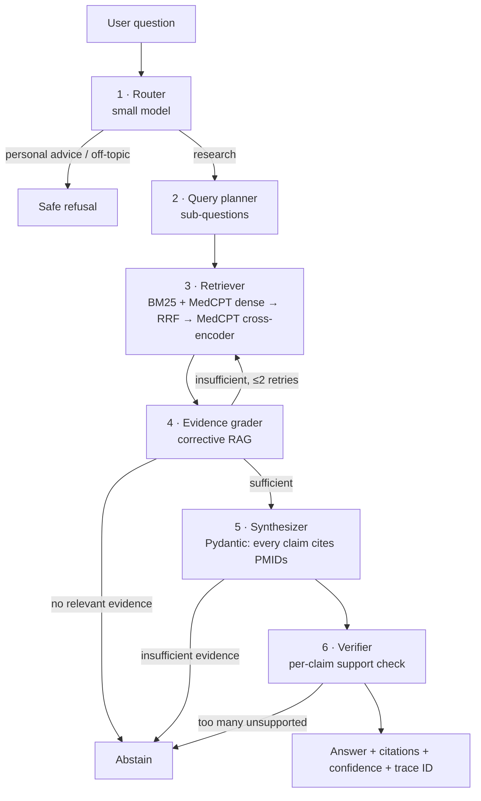

# ClinSynapse

**An agentic biomedical question-answering system that answers from PubMed with verifiable citations, abstains when the evidence is weak, and is continuously evaluated in CI so quality can't silently regress.**

- Every claim is traceable to a specific PubMed article (PMID), and the claims are checked against those abstracts.
- It knows when not to answer: it refuses personal medical advice and abstains when the evidence is thin.
- Every design decision is backed by a measured ablation with bootstrap CIs and paired permutation tests.

> Research use only. Not medical advice.

<!-- GIF of the UI goes here -->

## Results

> **Pending first full run.** Generate with `make reproduce` (or `make evals && make report`), then paste `reports/results.md` here. Every number is a mean with a bootstrap 95% CI. A/B claims come from `evals.compare` (paired permutation test).

| Config | Accuracy | Macro-F1 | Citation validity | Faithfulness | Refusal acc. | $/1k q | p95 s |
|---|---|---|---|---|---|---|---|
| Full agent (gpt-oss-120b) | – | – | – | – | – | – | – |
| Single-shot RAG | – | – | – | – | – | – | – |
| Full agent (DeepSeek-V4.1-Flash) | – | – | – | – | – | – | – |

## Architecture



| Component | Choice |
|---|---|
| Orchestration | LangGraph, per-query budgets on steps, tokens and wall-clock time, with graceful degradation |
| Corpus | ~273k real PubMed abstracts (PubMedQA labeled + unlabeled + artificial). Titles and conclusions are excluded so the gold answer can't leak |
| Sparse | `bm25s` in-process (Elasticsearch planned for the 2.4M-abstract scale) |
| Dense | MedCPT article/query encoders → Qdrant (embedded, or server via `CS_QDRANT_URL`) |
| Fusion and rerank | Reciprocal rank fusion → MedCPT cross-encoder |
| LLMs | `gpt-oss-120b` (main, router) vs `DeepSeek-V4.1-Flash` (comparison), served by [Virginia Tech ARC's LLM API](https://docs.arc.vt.edu/ai/011_llm_api_arc_vt_edu.html). Any OpenAI-compatible endpoint works via `CS_LLM_BASE_URL` |
| Determinism | Temperature 0, pinned models, SQLite cache keyed by prompt hash for LLM calls, retrieval and judge verdicts |
| Safety | Router refusals, abstracts wrapped as untrusted data, indirect prompt-injection tests |

## Evaluation suite

| | |
|---|---|
| **Datasets** | PubMedQA labeled (1,000), BioASQ (bring your own JSON after free registration), hand-built golden set (`evals/datasets/golden.jsonl`), router probes (personal advice and off-topic) |
| **Retrieval** | Recall@k, MRR, nDCG@10 |
| **Answer** | Accuracy, macro-F1, key-fact recall |
| **Citations** | Validity (cited ∈ retrieved), precision, recall vs gold PMIDs |
| **Faithfulness** | Share of claims entailed by their cited abstracts, per claim, judged by DeepSeek-V4.1-Flash (a different model family from the gpt-oss verifier); NLI and gpt-oss judges are compared in calibration |
| **Behavior** | Refusal accuracy on unanswerable questions, false-refusal rate, router accuracy |
| **Agent** | Steps, retry-loop rate, tool-error rate, budget-hit rate |
| **Operations** | p50/p95 latency, tokens per query, $ per 1k queries |
| **Stats** | Bootstrap 95% CIs on every metric; paired permutation tests for every A/B (`evals/stats.py`) |
| **Fault injection** | Corrupted numbers, swapped citations, gold document removed, planted prompt injection (`evals/faults/`) |
| **Judge validity** | Inter-judge agreement (NLI vs gpt-oss-120b vs DeepSeek-V4.1-Flash, Cohen's κ) and fault sensitivity (does faithfulness drop when numbers are corrupted?). Not validated against human labels; see Limitations |
| **CI gate** | Every PR replays a 30-case smoke eval from a committed cache (no keys or models needed) and fails only if faithfulness, citation validity, accuracy or refusal accuracy drop past a threshold **and** p < 0.05 |

### Ablations

| Configuration | Question it answers |
|---|---|
| `single_shot` | Is the agent worth its extra cost and latency? |
| `bm25` / `dense` / `full` (hybrid) | Which retrieval works best for biomedical text? |
| `no_rerank` | Is the cross-encoder's latency justified? |
| `no_grader` | Does corrective retrieval help? |
| `no_verifier` | How much hallucination does the verifier remove, and what does it cost? |
| `alt_model` | gpt-oss-120b vs DeepSeek-V4.1-Flash: quality, latency, tokens |

## Judge agreement

> Pending the full run: `uv run python -m evals.judges.agreement reports/runs/pubmedqa-full-n300`.

| Judge pair | Agreement | κ |
|---|---|---|
| DeepSeek-V4.1-Flash vs gpt-oss-120b | – | – |
| DeepSeek-V4.1-Flash vs NLI | – | – |
| gpt-oss-120b vs NLI | – | – |

Agreement is not accuracy: judges can agree and all be wrong. A human-labeled calibration set is supported (`ui/label.py`, `evals/judges/calibration.py`) but not done.

## What I learned / what failed

> Written from measured results after the first full run.

## Limitations

- The index is ~273k PubMedQA abstracts, not all of PubMed, so many real questions will (correctly) abstain. The 2.4M subset and Elasticsearch are the next step.
- Abstracts only: no full text, tables or figures.
- PubMedQA questions are derived from article titles. Titles are excluded from the index, but retrieval on PubMedQA is still easier than open-world search.
- Faithfulness is scored by an LLM judge (DeepSeek-V4.1-Flash) that has not been validated against human labels. Inter-judge agreement and fault sensitivity are the only evidence it works. In one inspected case the NLI judge rejected a near-verbatim claim, so judge choice matters.
- The NLI judge sees at most 512 tokens of evidence per claim.
- ARC is free for VT users, so `$/1k queries` is a reference cost at public list prices (`src/clinsynapse/llm/client.py`). Models without a listed price report $0.

## Reproduce

```bash
cp .env.example .env          # add your VT ARC key (OPEN_AI_API_KEY)
make llm-check                # verify key, models, JSON mode
make reproduce                # setup → index (~40 min on M-series) → tests → evals → reports/report.html
```

Run pieces individually:

```bash
make index                                              # build the PubMed index
make serve & make ui                                    # API on :8000, UI on :8501
uv run python -m evals.run --dataset pubmedqa --limit 200 --preset full
uv run python -m evals.compare reports/runs/pubmedqa-single_shot-n200 reports/runs/pubmedqa-full-n200
make baseline                                           # re-record the CI smoke cache and baseline
docker compose up                                       # API, UI, Qdrant, Langfuse
```

## Repo layout

```
src/clinsynapse/
  graph/       LangGraph nodes: router, planner, retriever, grader, synthesizer, verifier
  retrieval/   corpus, BM25, MedCPT dense, RRF fusion, cross-encoder rerank, index builder
  llm/         OpenAI-compatible client, prompt-hash cache, structured outputs, cost accounting
  api/         FastAPI (+ SSE streaming), support-sentence highlighting
evals/
  datasets/  metrics/  judges/  faults/  stats.py  gate.py  run.py  compare.py  report.py
ui/            Streamlit page
reports/       generated results, committed baselines
tests/
```

The v1 Deno/TypeScript implementation (`agents/`, `server/`, `AgentInterface/`) is still in the repo for reference.

## License

MIT © 2025 Siddharth Pal
