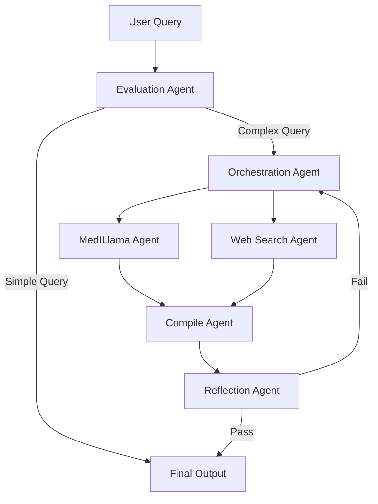

# 🧠 ClinSynapse

> **A Multi-Agent Biomedical Research Assistant**  
> Powered by LangGraph · LangChain · Deno · Groq Llama 3.3 · Ollama · Tavily

[](https://deno.land)
[](https://www.typescriptlang.org/)
[](https://www.langchain.com)
[](https://groq.com)
[](https://ollama.ai)
[](https://www.tavily.com)
[](./LICENSE)
[]()

---

## 🌐 Overview

**ClinSynapse** is an intelligent **multi-agent biomedical research framework** that decomposes complex medical queries, orchestrates specialized AI agents, and compiles evidence-grounded answers.  
It leverages **LangGraph** for dynamic workflow orchestration and **LangChain** for structured reasoning, combining a clinical LLM (MedILlama) with real-time information retrieval (Tavily).

> ⚕️ **Disclaimer:** ClinSynapse is designed for research and educational purposes only. It is *not* a substitute for professional medical advice.

---

## 🧩 System Architecture

### 🧠 Agent Orchestration Flow



This LangGraph-based design ensures conditional routing and parallel agent execution, creating an iterative feedback loop that refines each response.

### 🧩 Core Agents

| Agent | Description |
|:------|:-------------|
| **Evaluation Agent** | Classifies queries as *simple* or *complex* and routes accordingly. |
| **Orchestration Agent** | Decomposes complex questions into actionable sub-tasks and assigns them to agents. |
| **MedILlama Agent** | Performs in-depth clinical and biomedical reasoning using domain-tuned models. |
| **Web Search Agent** | Fetches and summarizes recent research using Tavily’s API. |
| **Compile Agent** | Merges outputs from all agents into a unified draft. |
| **Reflection Agent** | Evaluates quality, correctness, and completeness; triggers iterative refinement. |

### 🧱 Technology Stack
- **LangGraph** — Directed graph orchestration for conditional, stateful flows.
- **LangChain** — Modular LLM pipelines and prompt templates.
- **Deno v2.1.6** — TypeScript-native runtime with secure permissions.
- **Groq Llama 3.3-70B** — High-throughput LLM for orchestration and summarization.
- **LightEternal-Llama3-Merge-Biomed-8B** — Specialized SLM for biomedical analysis.
- **Tavily** — Medical search API for real-time, source-based retrieval.

---

## 🔁 End-to-End Workflow

1. **Evaluation** — Detect query complexity.  
2. **Decomposition** — Generate tasks via `taskDecompositionPrompt`.  
3. **Parallel Agents** — Execute **MedILlama** and **WebSearch** concurrently.  
4. **Compilation** — Merge multi-agent results into a coherent draft.  
5. **Reflection** — Assess and refine for quality (loop up to 3 iterations).  
6. **Finalization** — Output the validated response with references.

This architecture supports iterative self-improvement and scalable agent expansion (future RAG integration).

---

## ⚙️ Installation & Setup

### 1️⃣ Environment Variables
Create a `.env` file in the root:
```bash
GROQ_API_KEY=YOUR_GROQ_API_KEY
TAVILY_API_KEY=YOUR_TAVILY_API_KEY
OLLAMA_MODEL=hf.co/featherless-ai-quants/lighteternal-Llama3-merge-biomed-8b-GGUF:Q8_0
OLLAMA_BASE_URL=http://localhost:11434
```

### 2️⃣ Run the Backend (Deno)
```bash
deno run --allow-env --allow-net --allow-read server/ws.ts
# or HTTP mode:
deno run --allow-env --allow-net --allow-read server/http.ts
```

### 3️⃣ Start the Frontend
```bash
cd AgentInterface
npm install
npm run dev
```
Access the interface at **http://localhost:5173**.

---

## 💬 Usage

### 🖥️ Web UI
- Type your medical question.
- View agent-specific outputs (MedILlama, WebSearch, Compile).
- The system auto-iterates until quality passes or `MAX_ITERATIONS` is reached.

### ⚡ API (Programmatic)
- **HTTP:**  `POST http://localhost:8080`  → `{ "userQuery": "your question" }`
- **WebSocket:**  connect to `ws://localhost:8080` for streaming state updates and partial tokens.

---

## 🧠 Example Showcase — Cancer Research Analysis

Below is a real example generated by ClinSynapse summarizing breakthroughs in **cancer treatment research (2025)**:

> ### **Highlights:**
> - Immunotherapy (PD-1/PD-L1 inhibitors) improving survival in melanoma & lung cancer.
> - Targeted therapies (TKIs, PARP inhibitors) personalizing care.
> - CAR-T cell therapy revolutionizing hematologic malignancies.
> - Precision medicine optimizing genomic-based treatment plans.
> - Neoantigen vaccines demonstrating promise in early clinical trials.

**Excerpt:**
> *Recent advancements in cancer treatment focus on targeted, immune-based, and personalized therapies. The integration of AI in diagnostics and drug development is accelerating discovery. The next frontier emphasizes nanoparticle-mediated delivery, adaptive clinical trials, and disruptive innovation funding to transform patient outcomes.*

👉 *See full research output in [`output.md`](./output.md)*

---

## 🧩 Technical Notes

- **Parallel Agents:** MedILlama & WebSearch run concurrently to reduce latency.
- **Streaming:** Token and state updates stream to the frontend in real time.
- **Iteration Limit:** `MAX_ITERATIONS = 3` (configurable in `config.ts`).
- **LLM Roles:** Groq → orchestration & summarization; Ollama → domain medical reasoning.
- **Extensible:** Add new agents (e.g., PubMed retriever) via `agentGraph.ts` nodes.

---

## 🚧 Roadmap

- [ ] Integrate **RAG Agent** for PubMed/PMC retrieval.
- [ ] Extend reflection feedback with factual verification.
- [ ] Add **confidence scoring** & hallucination detection.
- [ ] Introduce a **graphical pipeline explorer** for LangGraph.
- [ ] Build a hosted web dashboard for non-technical users.

---

## 🤝 Contributing

Contributions are welcome! Open issues or pull requests to discuss ideas or improvements.
Please follow [Conventional Commits](https://www.conventionalcommits.org) and ensure clean Deno lint/format before PR.

---

## ⚖️ License & Disclaimer

### License
Released under the [MIT License](./LICENSE).  
© 2025 Siddharth Pal — derived from original work © 2024 abhigyanpatwari.

### Disclaimer
This project provides **information only**.  
It does **not** offer medical diagnosis or treatment advice.  
Always consult qualified professionals for healthcare decisions.

---

## 🌟 Acknowledgments

Gratitude to the open-source communities of **LangChain**, **LangGraph**, and **Ollama**.  
Special thanks to mentors and collaborators at **IIT BHU**, **Siemens**, and **Manipal University Jaipur** for research guidance and support.

> *ClinSynapse bridges computation and clinical reasoning — empowering medical research through intelligent agent collaboration.*
