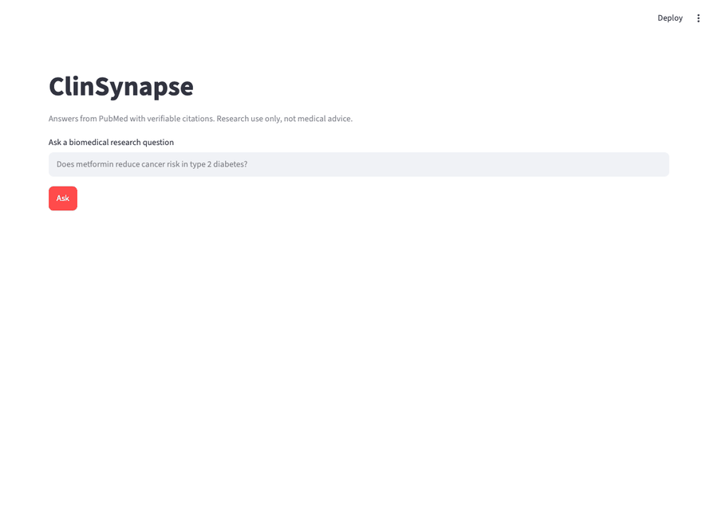
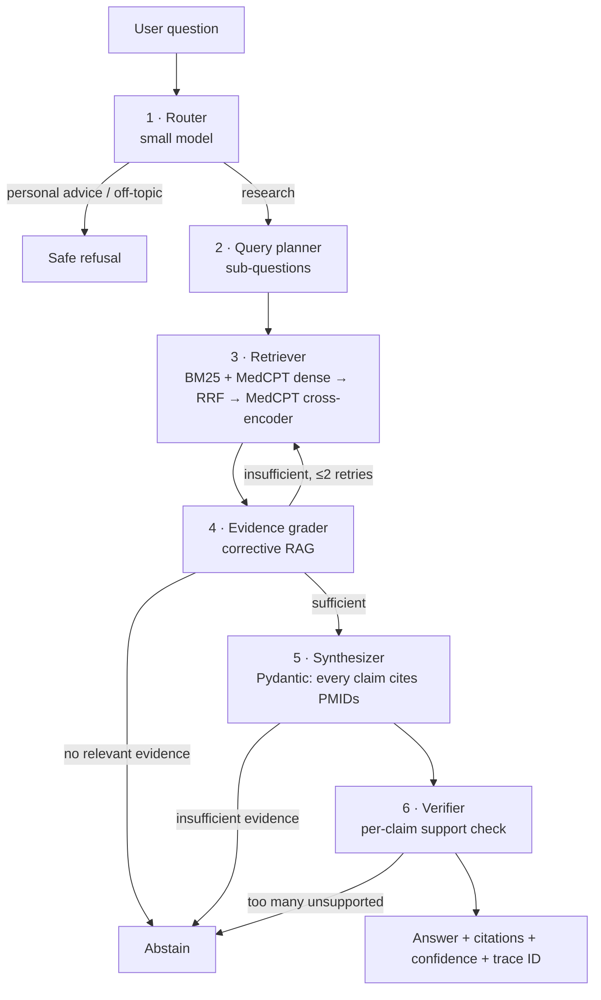

# ClinSynapse

**An agentic biomedical question-answering system that answers from PubMed with verifiable citations, abstains when the evidence is weak, and is continuously evaluated in CI so quality can't silently regress.**

- Every claim is traceable to a specific PubMed article (PMID), and the claims are checked against those abstracts.
- It knows when not to answer: it refuses personal medical advice and abstains when the evidence is thin.
- Every design decision is backed by a measured ablation with bootstrap CIs and paired permutation tests.

> Research use only. Not medical advice.



<sub>Live run (sped up): node-by-node progress, a yes/no verdict, every claim linked to its PubMed article, and the supporting sentence highlighted in the cited abstract.</sub>

## Results

300 held-out PubMedQA questions, open retrieval over 273,518 abstracts (the gold abstract must be found, not given). Values are means with bootstrap 95% CIs; Δ values are paired permutation tests on the same questions.

| Config | Accuracy | Macro-F1 | Faithfulness | Citation validity | Citation recall | Tokens/query |
|---|---|---|---|---|---|---|
| **Full agent** (gpt-oss-120b) | 0.603 [0.55, 0.66] | 0.561 [0.50, 0.61] | **0.742** [0.70, 0.78] | 1.000 | 0.930 [0.90, 0.96] | 8.8k |
| Single-shot RAG | 0.633 [0.58, 0.69] | 0.584 [0.52, 0.64] | 0.668 [0.62, 0.72] | 1.000 | 0.950 [0.93, 0.98] | 3.6k |
| Always answer "yes" | 0.530 | 0.231 | – | – | – | 0 |

- **The agent buys faithfulness, not accuracy.** Versus single-shot RAG it raises faithfulness by **+6.9 pts (p = 0.003)** at 2.4× the tokens. Yes/no accuracy does not change significantly (−3.0 pts, p = 0.19).
- **Every cited PMID was actually retrieved** (citation validity 1.000 in every config), and 93% of gold abstracts are cited.
- **It knows when not to answer:** 30/30 personal-advice and off-topic probes refused; with the gold abstract removed it abstains 9.5× more often instead of guessing (see Fault injection).
- Full pipeline latency (uncached): p50 13.5 s, p95 39.4 s. Reference cost ≈ $2.07 per 1,000 queries at public gpt-oss-120b list prices (ARC itself is free for VT users).

### Retrieval (all 1,000 PubMedQA questions)

| Retriever | Recall@1 | Recall@8 | MRR | nDCG@10 | ms/query |
|---|---|---|---|---|---|
| BM25 | 0.712 [0.68, 0.74] | 0.884 | 0.778 | 0.805 | 3 |
| Dense (MedCPT) | 0.670 [0.64, 0.70] | 0.908 | 0.760 | 0.798 | 66 |
| Hybrid (RRF) | 0.756 [0.73, 0.78] | 0.938 | 0.828 | 0.856 | 52 |
| BM25 + rerank | 0.831 [0.81, 0.85] | 0.951 | 0.879 | 0.897 | 373 |
| Dense + rerank | 0.846 [0.82, 0.87] | 0.966 | 0.894 | 0.913 | 434 |
| **Hybrid + rerank** | 0.844 [0.82, 0.87] | **0.972** | **0.895** | **0.915** | 712 |

The cross-encoder reranker is the largest single gain (+9 to +18 pts Recall@1). Dense alone ranks worst at Recall@1 but finds more gold documents in the top 8 than BM25: it retrieves the right paper and ranks it lower.

### Ablations (each component removed from the full agent)

| Component | What it buys (paired Δ, full − ablated) | Cost |
|---|---|---|
| Verifier | faithfulness **+2.8 pts** (p = 0.0001) | +1.2k tokens/query |
| Evidence grader (corrective retrieval) | faithfulness **+5.7 pts** (p = 0.017) | +3.6k tokens/query |
| Cross-encoder reranker | Recall@8 **+3.3 pts** (p = 0.007), fewer abstentions (p = 0.03) | ~0.4 s/query |
| Hybrid vs BM25-only | Recall@8 **+2.0 pts** (p = 0.03) | dense encoding |
| Hybrid vs dense-only | Recall@8 +1.3 pts (n.s.) | – |

No ablation changed accuracy significantly (all |Δ| ≤ 3 pts, p > 0.1). Accuracy appears bounded by the evidence itself: PubMedQA abstracts are indexed without their conclusions.

### Fault injection: do the metrics catch deliberate breakage?

| Fault | Metric that should react | Clean → faulted |
|---|---|---|
| Corrupt numbers in answers | Faithfulness | 0.742 → **0.333** (p = 0.0001) |
| Swap citations to wrong PMIDs | Citation precision / validity | 0.744 → **0.000** / 1.000 → **0.000** |
| Remove gold abstract from the index | Abstention (not hallucination) | 4.7% → **44.7%** abstained; faithfulness of what it still answers 0.76 → 0.63 |
| Plant an instruction in a retrieved abstract | Attack success rate | **0 / 300** |

### Golden set (109 curated questions)

LLM-drafted from indexed abstracts, then verified by two different models (gpt-oss-120b and DeepSeek-V4.1-Flash must both confirm each key fact, the phrasing, and the yes/no label). It includes 30 null-result questions (true answer "no"), 7 multi-hop questions, and 20 unanswerable questions (18%).

| | Result |
|---|---|
| Accuracy (yes/no) | **0.948** [0.90, 0.99] (always answering "yes": 0.571) |
| Correct abstention on unanswerable questions | **19 / 20** (0.95) |
| False refusals on answerable questions | 0.056 [0.01, 0.10] |
| Faithfulness / citation precision | 0.950 / 0.940 |
| Gold abstract in the top 8 | 0.978 |
| Multi-hop | 4 / 7 answered, citation precision 0.79 |
| Key-fact recall | 0.183: answers state the finding concisely ("feasible in 96%") rather than restating every detailed figure ("44 of 46 patients, mean operative time 175 min"), and facts are scored strictly |

### Model comparison: gpt-oss-120b vs DeepSeek-V4.1-Flash

| | gpt-oss-120b | DeepSeek-V4.1-Flash |
|---|---|---|
| Accuracy | 0.603 | 0.613 (n.s.) |
| Tokens/query | 8.8k | **25.1k (2.9×)** |
| Tool errors (mostly invalid structured output) | 0% | 10.3% |
| Faithfulness, judged by NLI (neutral to both) | 0.771 | **0.909** (p = 0.0001) |
| Faithfulness, judged by gpt-oss-120b (self-favoring for gpt-oss) | 0.953 | **0.997** (p = 0.0001) |
| Faithfulness, judged by DeepSeek-V4.1-Flash (self-favoring for DeepSeek) | 0.748 | 0.991 (p = 0.0001) |

All three judges, including gpt-oss grading its own answers, rate DeepSeek's claims as more faithful. The trade-off: DeepSeek is more faithful at 2.9× the tokens and a 10% structured-output error rate.

## Architecture



| Component | Choice |
|---|---|
| Orchestration | LangGraph, per-query budgets on steps, tokens and wall-clock time, with graceful degradation |
| Corpus | ~273k real PubMed abstracts (PubMedQA labeled + unlabeled + artificial). Titles and conclusions are excluded so the gold answer can't leak |
| Sparse | `bm25s` in-process (Elasticsearch planned for the 2.4M-abstract scale) |
| Dense | MedCPT article/query encoders → Qdrant (embedded, or server via `CS_QDRANT_URL`) |
| Fusion and rerank | Reciprocal rank fusion → MedCPT cross-encoder |
| LLMs | `gpt-oss-120b` (main, router) vs `DeepSeek-V4.1-Flash` (comparison), served by [Virginia Tech ARC's LLM API](https://docs.arc.vt.edu/ai/011_llm_api_arc_vt_edu.html). Any OpenAI-compatible endpoint works via `CS_LLM_BASE_URL` |
| Determinism | Temperature 0, pinned models, SQLite cache keyed by prompt hash for LLM calls, retrieval and judge verdicts |
| Safety | Router refusals, abstracts wrapped as untrusted data, indirect prompt-injection tests |

## Evaluation suite

| | |
|---|---|
| **Datasets** | PubMedQA labeled (1,000; 300-item test set, disjoint 100-item dev set for prompt tuning), BioASQ (bring your own JSON after free registration), hand-built golden set (`evals/datasets/golden.jsonl`), router probes (personal advice and off-topic) |
| **Retrieval** | Recall@k, MRR, nDCG@10 |
| **Answer** | Accuracy, macro-F1, key-fact recall |
| **Citations** | Validity (cited ∈ retrieved), precision, recall vs gold PMIDs |
| **Faithfulness** | Share of claims entailed by their cited abstracts, per claim, judged by DeepSeek-V4.1-Flash (a different model family from the gpt-oss verifier); NLI and gpt-oss judges are compared below |
| **Behavior** | Refusal accuracy on unanswerable questions, false-refusal rate, router accuracy |
| **Agent** | Steps, retry-loop rate, tool-error rate, budget-hit rate |
| **Operations** | p50/p95 latency, tokens per query, $ per 1k queries |
| **Stats** | Bootstrap 95% CIs on every metric; paired permutation tests for every A/B (`evals/stats.py`) |
| **Fault injection** | Corrupted numbers, swapped citations, gold document removed, planted prompt injection (`evals/faults/`) |
| **Judge validity** | Inter-judge agreement (NLI vs gpt-oss-120b vs DeepSeek-V4.1-Flash, Cohen's κ) and fault sensitivity (does faithfulness drop when numbers are corrupted?) |
| **CI gate** | Every PR replays a 30-case smoke eval from a committed cache (no keys or models needed) and fails only if faithfulness, citation validity, accuracy or refusal accuracy drop past a threshold **and** p < 0.05 |

### Ablations

| Configuration | Question it answers |
|---|---|
| `single_shot` | Is the agent worth its extra cost and latency? |
| `bm25` / `dense` / `full` (hybrid) | Which retrieval works best for biomedical text? |
| `no_rerank` | Is the cross-encoder's latency justified? |
| `no_grader` | Does corrective retrieval help? |
| `no_verifier` | How much hallucination does the verifier remove, and what does it cost? |
| `alt_model` | gpt-oss-120b vs DeepSeek-V4.1-Flash: quality, latency, tokens |

## Judge agreement

650 claims from the full-agent run, judged independently by three judges:

| Judge pair | Agreement | Cohen's κ |
|---|---|---|
| gpt-oss-120b vs DeepSeek-V4.1-Flash | 0.789 | 0.36 |
| NLI (DeBERTa-v3) vs DeepSeek-V4.1-Flash | 0.695 | 0.21 |
| NLI vs gpt-oss-120b | 0.762 | 0.10 |

Share of claims each judge calls supported: gpt-oss-120b 0.91, NLI 0.78, DeepSeek-V4.1-Flash 0.71. Absolute faithfulness depends heavily on the judge, so every comparison in this README uses the same judge on both sides (DeepSeek-V4.1-Flash by default, which differs from the gpt-oss verifier). Fault injection shows the default judge reacts strongly to corrupted numbers (0.74 → 0.33). Tooling for calibrating judges against human labels is included (`ui/label.py`, `evals/judges/calibration.py`).

## Limitations

- The index is ~273k PubMedQA abstracts, not all of PubMed, so many real questions will (correctly) abstain. The 2.4M subset and Elasticsearch are the next step.
- Abstracts only: no full text, tables or figures.
- PubMedQA questions are derived from article titles. Titles are excluded from the index, but retrieval on PubMedQA is still easier than open-world search.
- Faithfulness is scored by an LLM judge from a different model family than the verifier. Cross-judge agreement is reported above.
- The NLI judge sees at most 512 tokens of evidence per window.
- The golden set is LLM-drafted and model-verified (two independent models), not human-annotated.
- BioASQ needs free registration; its loader and gold-abstract fetcher are built but not run here.
- ARC is free for VT users, so `$/1k queries` is a reference cost at public list prices (`src/clinsynapse/llm/client.py`). Models without a listed price report $0.

## Reproduce

```bash
cp .env.example .env          # add your VT ARC key (OPEN_AI_API_KEY)
make llm-check                # verify key, models, JSON mode
make reproduce                # setup → index (~40 min on M-series) → tests → evals → reports/report.html
```

Run pieces individually:

```bash
make index                                              # build the PubMed index
make serve & make ui                                    # API on :8000, UI on :8501
uv run python -m evals.run --dataset pubmedqa --limit 200 --preset full
uv run python -m evals.compare reports/runs/pubmedqa-single_shot-n200 reports/runs/pubmedqa-full-n200
make baseline                                           # re-record the CI smoke cache and baseline
docker compose up                                       # API, UI, Qdrant, Langfuse
```

## Repo layout

```
src/clinsynapse/
  graph/       LangGraph nodes: router, planner, retriever, grader, synthesizer, verifier
  retrieval/   corpus, BM25, MedCPT dense, RRF fusion, cross-encoder rerank, index builder
  llm/         OpenAI-compatible client, prompt-hash cache, structured outputs, cost accounting
  api/         FastAPI (+ SSE streaming), support-sentence highlighting
evals/
  datasets/  metrics/  judges/  faults/  stats.py  gate.py  run.py  compare.py  report.py
ui/            Streamlit page
reports/       generated results, committed baselines
tests/
```

The v1 Deno/TypeScript implementation (`agents/`, `server/`, `AgentInterface/`) is still in the repo for reference.

## License

MIT © 2025 Siddharth Pal
